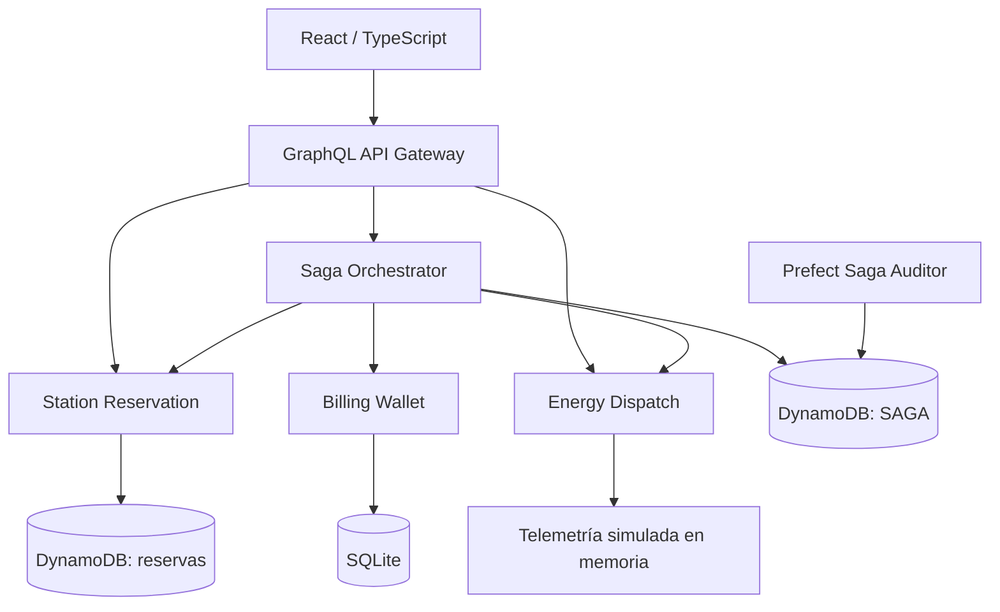
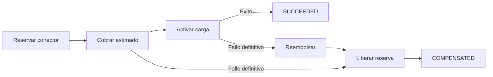

# AegisVolt | Plataforma de gestión de carga eléctrica

Proyecto final de Patrones Arquitectónicos Avanzados. AegisVolt simula la gestión de estaciones de carga para flotas eléctricas, coordinando la reserva de conectores, el cobro de una billetera y la activación de sesiones de carga mediante microservicios.

> Proyecto académico: los pagos y el hardware son simulados. El funcionamiento local de la SAGA se ha probado; el despliegue AWS y la integración completa de CI/CD están pendientes de validación.

## Arquitectura



### Tecnologías

- Frontend: React, TypeScript, Vite, Tailwind CSS y Recharts.
- Backend: Python, FastAPI, GraphQL y boto3.
- Persistencia local: DynamoDB Local y SQLite.
- Infraestructura: Docker Compose, Terraform, AWS EKS, ECR, VPC, IAM y S3.
- Despliegue y observabilidad: Kubernetes, Helm, GitHub Actions, Prefect y CloudWatch.

## Estructura del repositorio

```text
AegisVolt/
├── .github/workflows/       # CI y despliegue
├── Frontend/                # Interfaz web
├── Microservicios/
│   ├── station-reservation-service/
│   ├── billing-wallet-service/
│   ├── energy-dispatch-service/
│   ├── saga-orchestrator-service/
│   ├── graphql-api-gateway/
│   ├── saga-auditor-service/
│   ├── shared/
│   ├── tests/
│   ├── deploy/helm/charging/
│   ├── terraform/
│   └── docker-compose.yml
├── .gitignore
└── README.md
```

## Ejecución local (Windows PowerShell)

Requisitos: Docker Desktop en ejecución, Git, Node.js compatible con la versión de Vite del proyecto y npm. Para infraestructura AWS también se requieren AWS CLI v2, Terraform >= 1.10, kubectl y Helm.

### 1. Iniciar el backend

Desde la raíz del repositorio:

```powershell
cd Microservicios
docker compose config
docker compose up -d --build
docker compose ps
```

| Servicio | Puerto | Función |
|---|---:|---|
| DynamoDB Local | 8010 | Persistencia local de reservas y SAGA |
| Station Reservation | 8001 | Disponibilidad y bloqueo de conectores |
| Billing Wallet | 8002 | Saldos, cobros y reembolsos simulados |
| Energy Dispatch | 8003 | Activación y telemetría simulada |
| Saga Orchestrator | 8004 | Coordinación y compensaciones |
| GraphQL Gateway | 8005 | Punto de entrada unificado |

Verificar salud y logs:

```powershell
8001..8005 | ForEach-Object { Invoke-RestMethod "http://localhost:$_/health" }
docker compose logs --tail 50 saga-orchestrator-service
```

La documentación REST se encuentra en `/docs` de los servicios FastAPI. El gateway GraphQL está en http://localhost:8005/graphql.

### 2. Iniciar el frontend

En otra terminal, desde la raíz:

```powershell
cd Frontend
npm ci
npm run build
npm run dev
```

Abrir http://localhost:5173. La interfaz permite consultar estaciones, iniciar sesiones y visualizar resultados de la SAGA y telemetría. La versión ampliada incorpora una vista de feature flags; comprobar que los archivos de esa versión estén instalados. El historial local del navegador no sustituye un registro persistente centralizado.

### 3. Preparar una billetera de prueba

```powershell
# Crear una billetera nueva; si ya existe, omitir esta petición.
Invoke-RestMethod -Method Post -Uri 'http://localhost:8002/wallets/fleet-1' -ContentType 'application/json' -Body '{"currency":"USD"}'
Invoke-RestMethod -Method Post -Uri 'http://localhost:8002/wallets/fleet-1/funds' -ContentType 'application/json' -Body '{"amount_cents":50000}'
Invoke-RestMethod 'http://localhost:8002/wallets/fleet-1'
```

Los importes se expresan en centavos. Los fondos de prueba están habilitados en Compose; no deben habilitarse para pagos reales.

## Patrón SAGA



El orquestador registra el progreso por `correlation_id` y utiliza operaciones idempotentes para evitar duplicar efectos al reintentar una misma solicitud. Una reserva rechazada puede producir `FAILED`; errores recuperables pueden dejar estados `RETRYABLE` o `COMPENSATION_PENDING`. La compensación no equivale a una transacción ACID distribuida: consiste en operaciones de negocio inversas.

### Prueba GraphQL exitosa

Abrir http://localhost:8005/graphql o ejecutar en PowerShell:

```powershell
$query = 'mutation Iniciar($input: StartChargingSessionInput!) { startChargingSession(input: $input) }'
$inputData = @{
    correlationId = [guid]::NewGuid().ToString()
    fleetId = 'fleet-1'
    connectorId = 'connector-1'
    estimatedAmountCents = 1200
    reservationDurationSeconds = 300
    chargingDurationSeconds = 60
}
$body = @{ query = $query; variables = @{ input = $inputData } } | ConvertTo-Json -Depth 10
$result = Invoke-RestMethod -Method Post -Uri 'http://localhost:8005/graphql' -ContentType 'application/json' -Body $body
$result | ConvertTo-Json -Depth 20
```

Con saldo suficiente, conector disponible y simulación de fallo desactivada, se espera `SUCCEEDED`. Para consultar la telemetría antes de que termine la sesión:

```powershell
$dispatchId = $result.data.startChargingSession.dispatch.dispatch_id
$body = @{ query = 'query T($id: ID!) { latestTelemetry(dispatchId: $id) }'; variables = @{ id = $dispatchId } } | ConvertTo-Json -Depth 5
Invoke-RestMethod -Method Post -Uri 'http://localhost:8005/graphql' -ContentType 'application/json' -Body $body | ConvertTo-Json -Depth 10
```

### Prueba de compensación

Desde `Microservicios`, en la versión base que usa la variable de entorno:

```powershell
$env:SIMULATE_CHARGER_HARDWARE_FAULT = 'true'
docker compose up -d --force-recreate energy-dispatch-service
```

Repetir la mutación anterior con un UUID nuevo, un conector disponible (por ejemplo `connector-2`) y saldo suficiente. Se espera `COMPENSATED`, reembolso del cobro y liberación del conector. Verificar:

```powershell
Invoke-RestMethod 'http://localhost:8001/connectors/connector-2/availability'
Invoke-RestMethod 'http://localhost:8002/wallets/fleet-1'
```

Restaurar el funcionamiento normal:

```powershell
$env:SIMULATE_CHARGER_HARDWARE_FAULT = 'false'
docker compose up -d --force-recreate energy-dispatch-service
```

Si se instaló la versión con flags dinámicas, revisar también el valor almacenado en DynamoDB, que puede prevalecer sobre la variable de entorno. Las flags de precios dinámicos y carga rápida aún no implementan toda la lógica de negocio.

## Observabilidad y persistencia

Ejecutar la auditoría Prefect desde `Microservicios`:

```powershell
docker compose --profile observability run --rm saga-auditor-service
docker compose logs --tail 100 saga-orchestrator-service
```

El auditor identifica SAGA pendientes o compensaciones incompletas; no modifica los registros. Los logs estructurados permiten correlacionar solicitudes por `correlation_id`.

Para consultar DynamoDB Local, utilizar una terminal separada de la sesión AWS real:

```powershell
$env:AWS_ACCESS_KEY_ID='local'
$env:AWS_SECRET_ACCESS_KEY='local'
Remove-Item Env:AWS_SESSION_TOKEN -ErrorAction SilentlyContinue
aws dynamodb list-tables --endpoint-url http://localhost:8010 --region us-east-1
aws dynamodb scan --table-name charging-sagas-local --endpoint-url http://localhost:8010 --region us-east-1
aws dynamodb scan --table-name connector-locks-local --endpoint-url http://localhost:8010 --region us-east-1
```

DynamoDB Local funciona en memoria: reiniciarlo elimina sus registros. SQLite utiliza el volumen `wallet-data`. La telemetría se mantiene en memoria del servicio de despacho.

Detener el entorno sin borrar deliberadamente los volúmenes:

```powershell
docker compose down
```

## Infraestructura AWS con Terraform

La infraestructura prevista incluye una VPC por ambiente, subredes públicas y privadas, NAT, EKS, ECR, roles IAM/IRSA, DynamoDB y CloudWatch. Los workspaces `dev`, `test` y `prod` separan el estado remoto en S3. Los archivos adicionales de la revisión incorporan tablas y endpoints, pero su integración completa está pendiente.

Usar una terminal con credenciales AWS federadas vigentes (no las credenciales locales de DynamoDB). El ambiente actual utiliza Ohio (`us-east-2`).

Desde la raíz:

```powershell
cd Microservicios\terraform
aws sts get-caller-identity
aws eks describe-cluster-versions --region us-east-2 --query "clusterVersions[?versionStatus=='STANDARD_SUPPORT'].clusterVersion" --output table
terraform init -reconfigure '-backend-config=backend.hcl'
terraform workspace list
terraform workspace select dev
terraform fmt -recursive
terraform validate
terraform plan '-var-file=dev.tfvars' '-out=dev.tfplan'
terraform show -no-color dev.tfplan
```

Los archivos `backend.hcl` y `dev.tfvars` se configuran localmente; no se publican. El bucket S3 debe existir con versionado y cifrado. Seleccionar una versión EKS con soporte estándar confirmada por AWS y actualizar la configuración antes de planificar. No utilizar un plan generado antes de modificar los archivos.

Solo después de revisar y aprobar el coste y los recursos del plan:

```powershell
terraform apply dev.tfplan
aws eks update-kubeconfig --region us-east-2 --name charging-dev
kubectl get nodes
terraform output
```

Validar el chart desde `Microservicios`:

```powershell
helm lint .\deploy\helm\charging
```

Para desplegar las aplicaciones se necesitan imágenes en ECR, valores Helm por ambiente, roles IRSA y el controlador de balanceo. No ejecutar una instalación Helm con valores incompletos. El workflow contiene la estrategia de despliegue prevista.

Para desmontar el ambiente de prueba, retirar primero los workloads y balanceadores creados por Kubernetes y revisar las dependencias (incluidas imágenes ECR). Desde Terraform, con el workspace correcto y credenciales vigentes:

```powershell
terraform workspace select dev
terraform plan -destroy '-var-file=dev.tfvars' '-out=destroy.tfplan'
# Solo tras revisar el plan de destrucción:
terraform apply destroy.tfplan
```

Verificar en AWS que no queden recursos facturables. El bucket de estado remoto no debe eliminarse por este procedimiento.

## CI/CD y estrategia Canary

Flujo previsto: `feature/* → dev → test → prod` mediante pull requests. CI ejecuta lint, pruebas, builds Docker y validación/plan Terraform. El despliegue está diseñado para publicar imágenes en ECR, desplegar con Helm y repartir inicialmente 90% del tráfico al servicio estable y 10% al canary, evaluar errores HTTP en CloudWatch y promover o revertir.

Configurar GitHub Environments `dev`, `test`, `prod`, protección de ramas, rol OIDC `AWS_ROLE_ARN`, variables `AWS_REGION`, `TF_STATE_BUCKET`, `EKS_API_ALLOWED_CIDRS`, `INGRESS_ALLOWED_CIDRS` y acceso de red autorizado para el runner. Revisar que el backend S3 del workflow use la misma clave que la configuración local. Mantener deshabilitado el workflow de despliegue hasta terminar la configuración; la versión revisada exige `ENABLE_AWS_DEPLOY=true` para ejecutarlo. La versión original no tiene esa protección.

## Estado del proyecto

| Componente | Estado |
|---|---|
| SAGA exitosa y compensación | Probadas localmente |
| GraphQL y telemetría | Probadas localmente |
| Auditoría Prefect | Ejecución local comprobada |
| Terraform | Validación local realizada; nuevo plan y apply pendientes |
| Billetera y despacho | SQLite y memoria; migración efectiva a DynamoDB pendiente |
| Feature flags | Revisión parcial; lógica de precios y prioridad pendiente |
| AWS, Canary y CI/CD | Configuración existente; ejecución integral pendiente |
| API Gateway privado, frontend remoto y TLS | Pendientes de integración y verificación |

No utilizar esta plataforma con pagos, credenciales de clientes ni cargadores reales sin implementar autenticación, autorización, almacenamiento durable y controles de seguridad adicionales.
